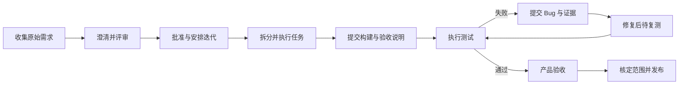

# FarFlow 研流 UI 设计说明

产品名及项目目录均确定为 FarFlow。UI 面向桌面研发协作，首先让用户明确“在哪个工作空间、哪种模式、哪个业务对象、下一步交给谁”。

## 视觉要求

用户已明确选择 **浅灰钴蓝** 作为默认方向，并要求其他配色都可切换。按明确名称对应到[第三轮浅灰钴蓝图片](previews/v3-03-浅灰钴蓝.png)，不把它误认成第六轮第三张深色稿。此前各轮保留为主题候选及迭代记录。

主题属于个人界面偏好：首次使用默认浅灰钴蓝，在外观设置中切换并在本机保留；不写进工作空间业务历史或 Git 数据。初始化、列表、详情、评论附件、成员管理与弹窗统一使用所选主题，状态文字及可读对比保持一致。

使用系统中文字体，正文以 14 至 16 像素为基准。表格、工具栏和详情面板依靠间距、字重、对齐和细分隔形成层级；状态必须同时有文字，不依赖颜色识别。避免彩色泳道底、大面积彩色侧栏和仪表盘卡片堆叠。

## 当前设计稿

默认实现参考为[浅灰钴蓝](previews/v3-03-浅灰钴蓝.png)。图中数据为虚构样例，设计稿尚未接入应用，主题切换尚未实现。桌面和浏览器共享 React 界面；Tauri 只用于桌面，独立服务端采用已确认的 Rust + Axum + PostgreSQL。

第六轮只修订颜色及对比层次，保留需求页、评论附件和三模式初始化布局，作为其他主题的视觉参考。具体色值和图片偏差见 [配色修订](配色修订.md)，完整指令见 [第六轮配色生成提示词](第六轮配色生成提示词.md)。

- [曜石银白](previews/v6-01-曜石银白.png)
- [雾白湖青](previews/v6-02-雾白湖青.png)
- [炭灰晴蓝](previews/v6-03-炭灰晴蓝.png)

第五轮页面记录，提示词见 [第五轮配色生成提示词](第五轮配色生成提示词.md)：

- [云白电蓝](previews/v5-01-云白电蓝.png)
- [月白鸢尾](previews/v5-02-月白鸢尾.png)
- [深空琥珀](previews/v5-03-深空琥珀.png)

第四轮页面记录：

- [石墨留白](previews/v4-01-石墨留白.png)
- [纸白深青](previews/v4-02-纸白深青.png)
- [墨岩工作台](previews/v4-03-墨岩工作台.png)

第三轮页面记录：

- [冷白靛蓝](previews/v3-01-冷白靛蓝.png)
- [暖白墨绿](previews/v3-02-暖白墨绿.png)
- [浅灰钴蓝](previews/v3-03-浅灰钴蓝.png)

第二轮页面记录：

- [需求评论与本地初始化](previews/v2-01-需求评论与本地初始化.png)
- [任务附件与 Git 初始化](previews/v2-02-任务附件与Git初始化.png)
- [测试复测与服务初始化](previews/v2-03-测试复测与服务初始化.png)

首轮记录：[需求与本地初始化](previews/v1-01-需求与本地初始化.png)、[任务与 Git 初始化](previews/v1-02-任务与Git初始化.png)、[测试与服务初始化](previews/v1-03-测试与服务初始化.png)。

生成方式为内置图像工具，修订稿以首轮图片为编辑目标。提示词包括以下共同要求：FarFlow 研流品牌、简体中文、当前日期 2026 年 10 月 25 日、桌面主屏与同风格初始化窗口、三种模式完整出现、需求任务测试 Bug 发布导航、自然比例和可读文字、统一黑白银灰、保留真实业务交接、评论回复及添加附件。各图分别聚焦需求评审与评论、任务提交验收与附件、测试失败到 Bug 复测和发布准备。完整生成及修订指令保留在本轮图像工具调用中。

## 初始化

三个模式始终并列显示，使用统一控件和选中样式。选择后仅切换配置表单，业务导航保持相同。

| 模式 | 主要填写内容 | 主操作 | 完成状态 |
| --- | --- | --- | --- |
| 本地 | 工作空间名称、保存目录、个人身份 | 创建工作空间 | 已保存在本机 |
| Git | 仓库地址或新建仓库、本地目录、协作者身份 | 连接并打开 | 本机已保存，显示同步状态 |
| 服务 | 服务地址、账户、可访问工作空间 | 连接工作空间 | 已连接团队服务 |

支持打开已有工作空间、返回上一步、字段校验和保留填写内容。连接检查失败要给出可操作原因；不能在失败后显示成功或跳进空白业务页面。已有工作空间切换模式进入迁移流程。

## 统一布局

主界面采用工作空间侧栏、轻量工具栏、业务列表或看板和按需打开的详情面板。固定业务入口为工作台、收集箱、需求、任务、测试、Bug、发布、文档，设置及成员位于侧栏底部。

需求以列表和内容详情为主，任务提供列表和看板，测试以测试单及用例执行列表为主，Bug 以缺陷列表和复测详情为主，发布以版本范围及交付检查为主。各自保留业务特征，评论、附件、动态和关联的交互保持一致。

## 评论和附件

需求、任务、测试用例、测试执行、Bug 和发布都提供评论与附件。详情面板至少有“内容、评论、附件、动态、关联”的清晰分区，窄面板通过页签切换，完整详情可并排显示内容和协作区。

| 功能 | 标准交互 |
| --- | --- |
| 评论 | 文字或 Markdown、提交、草稿保留、时间和作者 |
| 回复 | 回复具体评论，回看上下文，避免无层级长消息串 |
| 提及成员 | 选择当前工作空间成员；本地没有可提及成员时正常输入文本 |
| 评论附件 | 编辑时添加文件，提交后关联同一评论和业务对象 |
| 添加附件 | 点击选择、拖入文件、粘贴截图；显示名称、大小、进度和结果 |
| 文件查看 | 图片预览、适用类型预览、下载、移除引用及权限提示 |
| 错误处理 | 单文件失败可重试或取消，已成功文件不重复上传 |
| 动态 | 状态变化、指派、内容改版、附件增删和评论修改保留记录 |

上传区域的控件统一使用“添加附件”。本地模式显示“已保存在本机”；Git 模式区分“已保存在本机”和“待同步、已同步”；服务模式显示实际上传进度和服务保存结果。不能把本机保存当成团队已收到。

评论及附件继承业务对象的可见范围。服务端按成员权限校验查看、添加、下载和移除；Git 模式沿用可信团队和仓库可见性边界。评论编辑、删除和附件移除保留动态及必要墓碑，不能声称已从 Git 全部历史抹除。

## 标准业务交接

| 交接 | 页面必须表达的内容 |
| --- | --- |
| 原始需求转正式需求 | 原文、来源、场景、附件和双方互链 |
| 需求通过评审 | 当前内容版本、验收标准、评审意见及结果 |
| 需求拆任务 | 关联的需求版本、负责人、范围、优先级及交付要求 |
| 开发提交完成 | 完成说明、构建或提交引用、自验情况和必要附件，状态进入待验收 |
| 测试提交 Bug | 复现步骤、实际与预期、影响构建、环境、来源用例及截图或录屏 |
| 开发提交修复 | 解决方案、修复说明、修复构建，状态进入待复测 |
| 测试复测 | 结果、实际验证构建、说明及附件；失败重开，通过关闭 |
| 产品验收 | 对照需求验收标准，保存结论、操作者和依据版本 |
| 发布 | 构建、需求范围、修复 Bug、已知问题、测试及验收结论、发布说明和附件 |

每个交接动作在弹窗或详情操作区显示“当前状态 → 操作后状态”和下一处理人。没有处理说明时按规则提示补齐；工时可选，不编造工时。操作失败保留已填写内容。

## 框架和语言

| 层 | 技术 | 用途 |
| --- | --- | --- |
| 桌面框架 | Tauri 2 | 运行同一个桌面客户端，提供本机文件和系统能力 |
| 界面 | React、TypeScript、Vite | 共享页面、组件和构建，便于可选浏览器客户端复用 |
| 控件 | shadcn/ui、Tailwind CSS | 复用可定制控件、样式和可访问交互 |
| 业务表格 | TanStack Table | 排序、筛选、列宽、列显示和选择，按需接入 |
| 业务核心 | Rust | 三种模式共享业务对象、状态机、校验和操作格式 |
| 本地数据 | SQLite | 业务存储或 Git 模式查询索引 |
| 可选服务 | Rust Axum、PostgreSQL | 在线协作、集中鉴权和数据保存 |

上述技术表记录视觉设计阶段的选型，图片仍是视觉候选，不是可点击原型或已通过测试的应用。共享核心与本地存储已在后续阶段开始实现；当前实现与验证情况见 [交付进度](../docs/05-交付进度.md)。
