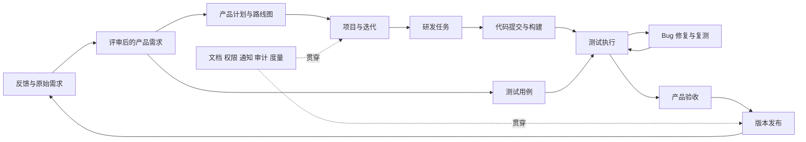

# 禅道整体业务与源码分析

禅道围绕产品价值、项目交付和研发质量组织业务。值得借鉴的是对象关系、责任交接、版本追踪与交付闭环；FarFlow 将在这些业务关系上提供本地、Git、服务三种运行模式。

## 分析范围

基线为官方开源仓库 22.6，提交 `d5bfff8c91cea48018275381e0a127ed6fa5c79f`。已盘点全部 101 个模块目录，检出模块主要控制器、业务模型、辅助模型、中文语言与配置文件；99 个目录包含 `model.php`。源码索引见本地 `.research/禅道源码模块索引.json`。

需求、任务、Bug、构建、发布、测试、项目关系和操作历史进行了重点静态阅读。其余模块结合入口、方法与字段配置进行业务归类。本报告不代表逐行审计，也不代表运行验证。公司现有实例显示为 21.7.6，不能把本次 22.6 的实现细节直接视为公司版本事实。

企业版、旗舰版、IPD 等能力通过官方产品页和手册补充分析；公开仓库中的表名、路由或简化模型，不能证明对应商业模块完整实现。官方手册与版本说明分别见[使用手册](https://www.zentao.net/book/zentaopms/38.html)、[企业版](https://www.zentao.net/zentao-biz.html)、[旗舰版](https://www.zentao.net/zentao-max.html)。

## 整体业务结构

### 四个管理对象

| 对象 | 管什么 | 与其他对象的关系 | FarFlow 的设计方向 |
| --- | --- | --- | --- |
| 项目集 | 业务方向、多个项目的统筹和资源 | 容纳产品及项目的管理范围 | 作为可选上层，小团队无需先建项目集 |
| 产品 | 长期要提供什么能力 | 持续积累需求、计划和发布，一个产品可以经历多个项目 | 保留为需求及版本的归属 |
| 项目 | 在目标、时间和资源约束下交付什么 | 可以关联多个产品，包含执行及团队 | 保留独立对象，避免简单固定成产品的子目录 |
| 执行 | 一次迭代、阶段或看板的具体工作 | 属于项目，组织需求、任务、构建和测试 | 用户界面称“迭代”或“阶段”，简单项目自动提供默认执行 |

产品和项目是交叉关联的两条线，不能简单设计成“项目集 → 产品 → 项目 → 执行”的唯一树。官方对[产品](https://www.zentao.net/book/zentaopms/Product-449.html)、[项目](https://www.zentao.net/book/zentaopms/Project-446.html)、[执行](https://www.zentao.net/book/zentaopms/Execution-1426.html)分别定义了目标、交付约束和具体工作。

### 三条业务线

## 业务全景

下表覆盖产品业务范围，不将每个技术目录都作为用户菜单。商业扩展依据官方说明列出，其可用范围需结合具体版本。

| 业务域 | 参与角色 | 主要业务及产出 | 源码或官方依据 | FarFlow 优先级 |
| --- | --- | --- | --- | --- |
| 个人工作台 | 每位成员 | 我的待办、任务、评审、Bug、动态、工作日志，汇总需要本人处理的事项 | `my`、`todo`、`block`、`message` | 首版 |
| 项目集与资源 | 负责人、项目经理 | 项目集、子项目集、人员投入、项目概览、干系人 | `program`、`personnel`、`stakeholder` | 后续增强 |
| 原始需求和反馈 | 提出人、产品经理、支持人员 | 收集问题及建议、澄清、分类、评审、转需求或 Bug、反馈进度 | `feedback`；官方需求池和工单说明 | 首版先做统一收集箱 |
| 产品与产品线 | 产品经理 | 产品、模块树、多分支、业务需求、用户需求、研发需求 | `product`、`branch`、`story`、`requirement`、`epic`、`tree` | 首版基础，后续多层级增强 |
| 产品计划与路标 | 产品经理 | 排期、需求优先级、版本目标、路线图、计划关联需求及 Bug | `productplan`，官方产品手册 | 首版计划，后续路线图 |
| 项目与执行 | 项目经理、团队 | 创建项目、关联产品、团队、迭代或阶段、启动、挂起、关闭 | `project`、`execution`、`programplan`、`stage` | 首版 |
| 研发任务 | 开发、设计、测试 | 任务分解、指派、工时、剩余工作、暂停、完成交接、关闭和重开 | `task` | 首版 |
| 看板与进度 | 团队、项目经理 | 卡片、泳道、列、在制品限制、燃尽、甘特及工作量视图 | `kanban`、`execution`；甘特见企业版说明 | 首版列表和看板，后续甘特 |
| 测试资产 | 测试人员 | 用例、步骤、预期、评审、用例库、套件及用例版本复用 | `testcase`、`caselib`、`testsuite` | 首版基础用例 |
| 测试执行 | 测试负责人 | 按构建组织测试单、分配用例、逐步执行、记录结果、产出报告 | `testtask`、`testreport` | 首版基础执行 |
| Bug | 测试、开发、产品 | 提交、确认、指派、修复、标记解决方案、复测、关闭、重新激活 | `bug` | 首版 |
| 构建与发布 | 开发、测试、发布负责人 | 提测构建、需求和 Bug 清单、测试结论、版本说明、已知问题、发布记录 | `build`、`release`、`projectbuild`、`projectrelease` | 首版 |
| DevOps | 开发、运维 | 代码库、提交关联、分支、评审请求、流水线、制品和代码扫描 | `repo`、`ppm`、`pipeline`、`artifact`、`codescan`、`gitfox`、`gitlab`、`jenkins` | 后续接入既有平台 |
| 文档与接口 | 产品、研发、测试 | 产品和项目空间、目录、文档、接口定义、版本、共享范围 | `doc`、`api`、`file`、`design` | 首版基础文档及附件 |
| 组织与权限 | 管理员、负责人 | 用户、部门、分组、操作权限、数据范围、项目成员和白名单 | `user`、`dept`、`group`、`personnel`、`sso` | 首版按模式提供 |
| 度量与报告 | 负责人、项目经理 | 进度、投入、质量、度量项、透视表、大屏、周报 | `metric`、`pivot`、`chart`、`screen`、`weekly`、`report` | 首版固定指标，后续自定义 |
| 流程与组织过程 | 流程管理员、质量负责人 | 自定义字段和工作流；评审、基线、变更、风险、问题、机会、过程裁剪和资产库 | 官方工作流、旗舰版及手册 | 后续增强 |
| 市场与 IPD | 产品负责人、决策者 | 市场调研、需求池、路标、立项、技术及决策评审 | 官方 IPD 说明与手册 | 远期扩展 |
| AI 与知识辅助 | 团队成员 | 模型配置、会话、知识检索、智能体、技能和工作辅助 | `ai`、`aiapp`、`zai`；官方 AI 说明 | 可选扩展 |
| 系统运行与扩展 | 管理员 | 备份、升级、回收站、搜索索引、导入、通知、应用集成和插件 | `backup`、`upgrade`、`search`、`convert`、`transfer`、`webhook`、`entry`、`extension` | 首版备份与导入，其余渐进 |
| OA 与运维扩展 | 非研发人员、运维 | 日常办公、假期和审批；主机、服务及上线管理等 | 官方企业版及手册 | 可独立扩展 |

官方[工作流说明](https://www.zentao.net/workflow-management.html)涵盖表单、动作、校验、审批、列表和提醒；这些是通用配置平台能力，成本明显高于固定研发流程，应在固定流程稳定后扩展。

## 角色怎样交接

| 角色 | 接收什么 | 负责什么 | 交给谁 |
| --- | --- | --- | --- |
| 需求提出人 | 业务问题 | 说明场景、目标和附件，回答澄清问题 | 产品经理 |
| 产品经理 | 原始需求和反馈 | 定义范围与验收标准，评审、排序、规划和产品验收 | 项目经理、开发、测试 |
| 项目经理 | 产品目标 | 组织项目、团队、迭代、任务、依赖和交付节奏 | 研发团队 |
| 开发人员 | 已明确需求、任务和 Bug | 实现、记录提交、提供构建、自验和修复说明 | 测试人员 |
| 测试人员 | 构建、需求和验收标准 | 执行用例、提交 Bug、复测和测试结论 | 开发及发布负责人 |
| 发布负责人 | 测试与验收结论 | 核定版本范围、已知问题、发布说明和交付记录 | 使用者、支持人员 |
| 管理员 | 组织和运行要求 | 管理工作空间、成员、权限、备份和集成 | 所有成员 |

同一人可以兼任多个角色，责任交接仍应留下记录。测试结论和产品验收是不同记录；开发完成、测试通过、产品验收、版本发布也应分别表达。

## 核心对象与关系

| 对象 | 关键业务信息 | 关联 |
| --- | --- | --- |
| 原始需求或反馈 | 提出人、来源、场景、价值、原文、处理结论 | 转换后的需求、Bug、任务；保留来源 |
| 需求 | 产品、模块、内容、验收标准、优先级、状态、研发阶段、内容版本 | 计划、项目、执行、任务、用例、Bug、发布 |
| 任务 | 所属项目和执行、负责人、工作内容、状态、工时、需求版本 | 需求、子任务、代码提交、相关 Bug |
| Bug | 复现步骤、预期和实际、环境、严重度、优先级、状态、解决方案 | 来源用例、需求、任务、影响构建、修复构建、发布 |
| 用例 | 前置条件、步骤、预期结果、版本 | 需求、套件、测试单、执行结果 |
| 测试单 | 测试范围、构建、负责人、时间 | 具体用例版本及执行结果 |
| 构建 | 产品、代码版本、产物、构建人、日期 | 实现需求、修复 Bug、测试单 |
| 发布 | 产品版本、范围、日期、说明、已知问题、状态 | 构建、需求、修复 Bug、遗留 Bug、测试结论 |
| 操作记录 | 操作者、动作、时间、字段变化和备注 | 对应对象及其版本 |

关系必须可回溯。例如打开一个已发布需求，应能定位任务、实现提交、提测构建、测试结果、修复 Bug 和所属发布。将这些对象全部混成一种无类型卡片，会丢失各自的校验和交付语义。

## 生命周期和业务规则

### 需求

禅道把“状态”和“研发阶段”分开。状态表达草稿、评审中、激活、变更中、关闭；阶段表达排期、设计、开发、测试、验收和发布进展。需求内容与验收标准另存版本，任务可以记录所依据的需求版本。

来源：`module/story/lang/zh-cn.php:265`、`db/zentao.sql:1847`、`db/zentao.sql:1966`、`db/zentao.sql:2005`；自动计算及人工验收规则见[需求状态和研发阶段](https://www.zentao.net/book/zentaopms/1721.html)。手册将状态数量写为“四种”但枚举了五项，本报告按实际枚举和源码处理。

FarFlow 应保留需求版本、变更原因、影响对象及重新确认机制。已批准需求发生实质变更时，不能悄悄覆盖开发和测试依据。

### 任务

源码区分未开始、进行中、已完成、暂停、取消和关闭。完成动作涉及负责人、完成时间、实际开始时间和工时；进度百分比依据消耗与剩余计算，不能单凭百分比认定已经验收或关闭。

源码：`module/task/lang/zh-cn.php:220`、`module/task/control.php:660`、`module/task/zen.php:950`、`module/task/model.php:1388`、`module/task/tao.php:236`。

FarFlow 首版可以使用“待处理 → 进行中 → 待验收 → 已关闭”，并提供暂停、取消和重开。工时可按工作空间设置为选填；没有工时不能被系统伪造为固定值。

### Bug

禅道的 Bug 状态为激活、已解决、已关闭，确认标记及解决方案分别保存。解决方案还包括重复、无法重现、设计如此、延期处理、外部原因等。“已解决”不能全部计为“代码已修复”。

`module/bug/model.php:487` 的解决流程校验解决方案和相关构建，记录附件、历史及关联；`module/bug/model.php:663` 独立处理关闭。`module/bug/zen.php:1296` 构造解决状态；中文枚举见 `module/bug/lang/zh-cn.php:271`。

FarFlow 应为开发保留“提交修复待复测”，为测试保留“复测通过关闭”及“失败重新打开”，并分别统计待修复、待复测、已关闭。

### 测试和发布

用例描述怎么验证，测试结果记录某次针对特定构建和用例版本的执行。修改用例不应改写过去的测试事实。数据表 `zt_testrun`、`zt_testresult` 都记录用例版本；业务入口见 `module/testtask/model.php:1458`。

构建是供测试或交付的技术版本，发布是对外确认的产品交付范围。源码分别使用 `build` 和 `release` 模块；发布会关联需求、修复 Bug、遗留 Bug 和构建，并影响需求阶段。来源：`db/zentao.sql:413`、`db/zentao.sql:1726`、`module/release/model.php:399`、`module/release/model.php:681`、`module/release/control.php:661`。

FarFlow 的“发布记录”应明确版本、范围及结论。实际部署、上传产物、创建 Git 标签和发送通知应是独立可配置动作。

## 不同管理方式的差异

| 方式 | 组织工作的方法 | 重点规则 | FarFlow 对应设计 |
| --- | --- | --- | --- |
| Scrum | 用有时间边界的迭代承接需求 | 迭代目标、任务分解、剩余工作、测试与复盘 | 首版迭代模板 |
| 看板 | 按工作流持续处理工作 | 泳道、列、在制品限制和阻塞原因 | 首版状态看板，后续在制品限制 |
| 瀑布 | 按设计、开发、测试等阶段推进 | 阶段计划、评审、交付物、变更与基线 | 基础阶段先支持，治理能力后续扩展 |
| 融合方式 | 阶段和迭代结合 | 上层计划与局部迭代关联 | 沿用统一执行对象并添加执行类型 |
| IPD 等治理方式 | 从市场、立项到开发决策 | 需求池、路标、决策及技术评审 | 预留业务域，单独设计专业流程 |

这些管理方式改变计划和门禁规则，不应导致同一条需求、Bug、文档出现几套互不关联的数据。源码执行类型包含 `stage`、`sprint`、`kanban`；项目与执行关系见 `module/execution/lang/zh-cn.php:537` 和 `module/project/model.php:2170`。

## 源码的组织方式

| 层 | 代表文件 | 实际职责 |
| --- | --- | --- |
| 框架 | `framework/base/control.class.php`、`framework/base/model.class.php` | 路由、控制器、全局上下文和数据库访问基础 |
| 控制器 | `module/task/control.php` | 接收页面请求、权限及上下文、组织流程、返回页面或结果 |
| 业务模型 | `module/story/model.php`、`module/bug/model.php` | 对象创建、状态动作、关联、统计和历史联动 |
| 辅助模型 | `module/task/tao.php`、`module/task/zen.php` | 计算、数据构造、表单和展示辅助，实际职责依模块而异 |
| 界面 | `module/task/ui/create.html.php`、`module/task/js/create.ui.js` | PHP ZIN 界面声明与 JavaScript 交互 |
| 配置和语言 | `module/task/config/form.php`、`module/task/config/dtable.php`、`module/task/lang/zh-cn.php` | 表单、列表、搜索、枚举及中文标签 |
| 数据层 | `db/zentao.sql`、`lib/dao/dao.class.php` | 关系表、索引、DAO 与迁移脚本 |
| 开放接口 | `config/apiv1.php`、`config/apiv2.php`、`framework/api` | 路由和 API 适配 |

这是服务端应用架构。大量流程直接使用当前用户、会话、表单和 DAO。面向本地及 Git 运行的新产品，应抽取业务概念重新组织实现，避免把页面控制器直接移植成三套业务。

### 数据设计中值得借鉴的部分

- 需求正文和验收标准保存为需求版本，关联任务保留版本依据。
- Bug 的状态、确认、优先级、严重度及解决方案独立表达。
- 构建、测试、发布分开；关联关系让交付可以追溯。
- 对象动态和字段变化分开记录。`action` 记录动作，`history` 记录字段旧值、新值及差异，见 `module/action/model.php:37`、`:652`、`db/zentao.sql:1076`。
- 权限同时涉及操作权限和数据范围，见 `module/group/model.php:511`、`:540`、`module/personnel/model.php:77`。

### 新产品宜重新设计的部分

- 禅道项目集、项目、执行共用 `zt_project` 表，常量映射见 `config/zentaopms.php:252`。FarFlow 宜使用明确对象类型和约束，避免调用时混淆 ID。
- 部分历史字段使用逗号分隔的多值关系；FarFlow 在关系数据库中使用关联表，在 Git 协议中使用稳定 ID 数组。
- 页面辅助、业务动作和副作用在部分流程中紧密关联；新产品将业务校验、存储提交、通知及外部集成拆开。
- 禅道的操作历史不是可直接拿来做分布式同步的事件协议；Git 数据模式需要自己的稳定版本、因果和冲突规则。

### Git 的两个用途

源码 `repo`、`ppm`、`pipeline` 等模块面向代码、提交关联、评审和流水线。需求、任务、Bug、发布仍有独立数据库表。FarFlow 所需的“把业务数据放入 Git”是另一项能力，应与“关联业务项目的源代码仓库”分别配置。

## 对 FarFlow 的取舍

首版应实现收集箱、需求、计划、项目与迭代、任务、基础测试、Bug、构建、发布、文档附件，以及贯穿它们的搜索、历史和备份。三种模式从架构开始统一，正式首版应具备三种模式的完整业务闭环。

项目集、甘特、复杂工作流、组织过程、IPD、OA、完整流水线编排和 AI 可以渐进扩展。整体业务分析涵盖这些领域，不表示首版同时承诺复制全部商业版功能。

源码许可原文保存在 `.research/zentao/LICENSE.CN`、`LICENSE.EN` 和 `COPYING`。本次仅静态研究，未安装或运行禅道源码，未修改公司禅道数据。
