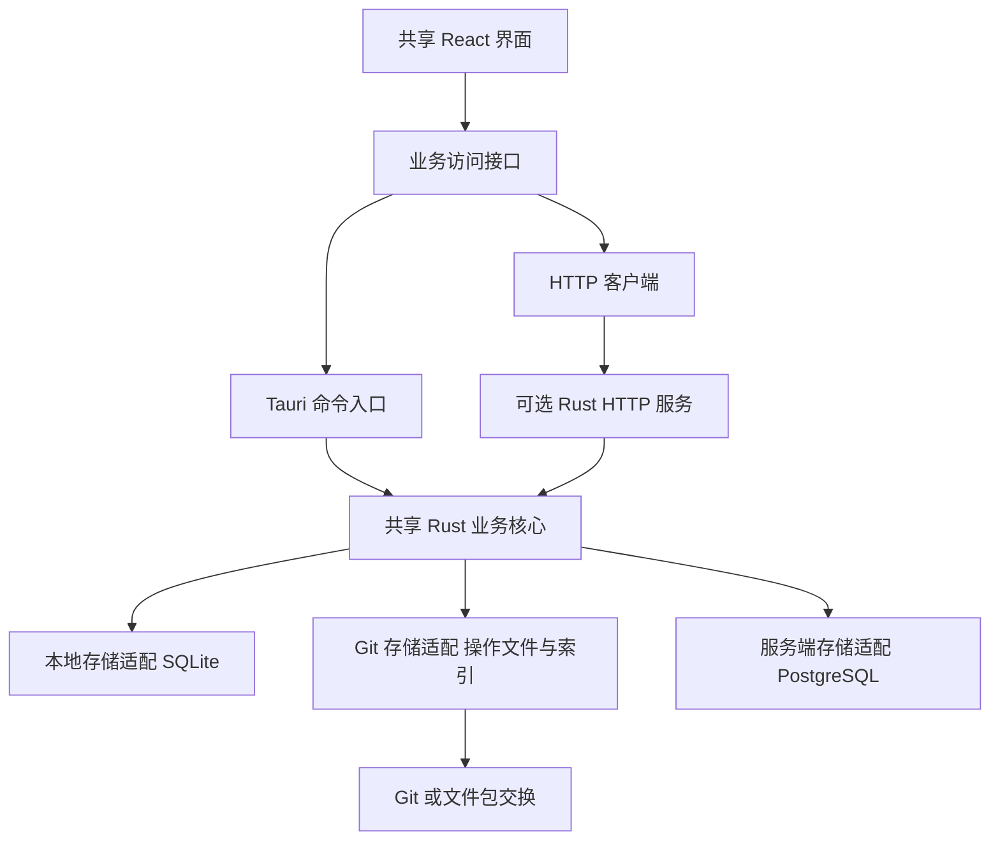

# FarFlow 技术与存储方案

已确认分开构建三部分：**Tauri 2 桌面客户端、React + TypeScript 共享界面、Rust + Axum + PostgreSQL 独立服务端**。Tauri 只负责桌面壳和本机能力，不进入服务端，也不作为浏览器界面的运行依赖。用户已明确确定服务端采用 Rust 和 PostgreSQL。

业务规则在 Rust 核心中实现一次。本地模式接 SQLite，Git 模式接结构化文件和本机 SQLite 索引；桌面的服务模式和浏览器界面通过同一 HTTP API 连接 Rust 服务端。PostgreSQL 仅由服务端管理，客户端不直接连接数据库。

本地和 Git 模式不监听业务 HTTP 端口，不要求安装 PostgreSQL 或 Redis。服务模式需要可选服务端，由团队按需部署。

## 语言与技术选择

| 部分 | 已确定方向 | 原因及边界 |
| --- | --- | --- |
| 界面 | React、TypeScript、Vite | 桌面和服务模式浏览器界面可以共用组件、状态及业务页面 |
| 控件与表格 | Radix Dialog、Tabler、普通 CSS 与浏览器表单控件 | 现有共享界面已使用；复杂表格能力出现实际需要时再引入成熟组件 |
| 桌面壳 | Tauri 2 | 前端通过命令调用 Rust，适合文件、数据库和 Git 等本机能力 |
| 业务核心 | Rust | 本地进程和服务端直接复用领域类型、校验、状态机及序列化代码 |
| 本地数据库 | SQLite | 嵌入应用，事务与索引可用，不需要独立数据库进程 |
| Git 数据格式 | UTF-8 JSON、Markdown、内容哈希文件 | 可版本管理、校验、交换，并可重建查询索引 |
| Git 执行 | 系统 Git 命令行 | 复用成熟的 Git 协议、认证和仓库操作，固定参数调用，不自建 Git 实现 |
| 可选服务端 | Rust、Axum | 使用共享业务核心，提供集中鉴权、业务命令和查询接口 |
| 服务端数据库 | PostgreSQL | 适合多人事务、关系约束和集中管理 |
| 缓存 | 首版不要求 Redis | 常用查询与持久队列先利用数据库；出现需要后再接缓存 |

Tauri 的前端和核心进程通过 IPC 通信，并支持 React、Vue 等前端框架；这里选择 React 是工程建议，不是 Tauri 的限制。见 [Tauri 进程模型](https://v2.tauri.app/concept/process-model/)、[IPC](https://v2.tauri.app/concept/inter-process-communication/)、[前端配置](https://v2.tauri.app/start/frontend/)。Axum 的路由和共享状态能力见[官方文档](https://docs.rs/axum/latest/axum/)。

服务端保持一个 Rust HTTP 进程、一个 PostgreSQL 实例和附件目录，首版不要求 Redis 或微服务。Rust 的价值是共享已有业务规则；学习和维护成本仍需计入工作量，不以语言性能代替实际容量验证。

## 同一套代码怎样组织



同一代码库可以产出桌面客户端、服务端程序和可选浏览器前端。“同一套代码”指共享业务实现和界面，不要求把无界面的服务端强行打包成依赖桌面环境的程序。

建议未来目录为：

```text
apps/desktop             桌面入口与 Tauri 适配
apps/web                 服务模式浏览器入口
packages/ui              共享界面
packages/client          命令和查询访问接口
crates/domain            业务对象 状态机 校验 事件
crates/application       业务用例与存储边界
crates/storage-sqlite    SQLite 存储与查询
crates/storage-git       操作文件 导入合并 投影
crates/storage-postgres  PostgreSQL 存储与查询
crates/server            HTTP 鉴权 会话 接口
```

这是前后端入口与可选后续拆分的建议结构。目前共享模型、状态规则、SQLite 和 Git 适配器位于 `crates/core`，账户、工作空间、PostgreSQL 业务存储和服务附件位于独立的 `crates/server`，二者均未依赖 Tauri；不为目录数量创建空模块。共享 React 浏览器界面已实现并有真实服务流程证据，桌面壳与本机能力仍待接入。运行和当前存储协议见 [服务账户](10-服务账户与运行.md)及[服务工作空间](11-服务工作空间与业务协议.md)。当前完整空间投影和内存筛选属于已实现方案，后续仍需达到原定性能目标。

共享核心不依赖 Tauri、HTTP 请求、界面状态或当前页面地址。客户端提交有类型的业务命令；核心读取当前对象、校验操作、产生业务变化，由适配器完成持久化。界面不直接执行 SQL，也不直接修改 Git 业务文件。

模式判断集中在工作空间初始化和适配器装配。业务页面使用能力信息呈现同步、成员和通知差异，避免每个按钮各写三份实现。

## 每种模式的数据真源

| 模式 | 唯一权威数据 | 可重建数据 | 禁止形成的双重主库 |
| --- | --- | --- | --- |
| 本地 | SQLite 中的业务数据及操作日志，附件文件另有清单 | 搜索索引、统计缓存 | 同时用另一份 JSON 作为可独立修改的业务主库 |
| Git | 受格式约束的操作文件、版本化正文和附件引用 | 本机 SQLite 投影及搜索索引 | 同时修改 SQLite 和仓库当前状态并互相覆盖 |
| 服务 | PostgreSQL 中的业务数据及操作日志，服务端附件另有清单 | 客户端缓存、Redis 缓存、统计缓存 | 客户端数据库与服务端同时各自接收离线权威写入 |

三种模式共享业务事件格式，但不强制使用同一种物理存储。服务模式首版不做离线写后自动回传，避免引入第四套合并协议。

## 本地模式

```text
工作空间目录/
  workspace.json     工作空间 ID 模式 格式版本
  data.sqlite        业务数据 操作日志 本地事务
  attachments/       按内容哈希存放附件
  backups/           备份包
```

本地保存使用事务，业务对象变化与操作日志一起提交。数据库启动时执行版本迁移，迁移前保存可恢复备份。文件使用先写临时文件、校验、原子落位的流程，数据库只引用已落位的附件。

本机应用访问本机 SQLite；多人协作不共用网盘或网络目录中的一个运行中数据库。SQLite 官方明确说明 WAL 依赖同机共享内存，不适用于多机网络文件系统，见 [SQLite WAL](https://sqlite.org/wal.html)。

备份使用数据库备份 API 或已验证的一致性快照方法，不能只复制一个正在写入的 `.sqlite` 文件而遗漏 WAL。官方备份 API 会产生一致快照，见 [SQLite Backup API](https://www.sqlite.org/backup.html)。

## Git 模式

当前已实现操作图、语义合并、明确决策、真实仓库、离线文件包、索引恢复及远端网络同步，详见 [Git 操作协议](06-Git操作协议.md)、[实际仓库存储](07-Git仓库存储与离线交换.md)及[远端同步](08-Git远端同步.md)。同步中心界面、取消和超时仍需继续实现。

### Git 存什么

Git 可以承载需求、任务、Bug、用例、发布、评论及业务历史等结构化记录。它负责传输和版本保存，业务核心负责理解数据与校验合并结果。

建议使用独立的业务数据仓库。项目源代码仓库只是关联对象，业务同步不能顺带提交、重置或推送用户的源代码改动。

早期建议的分文件结构如下，实际首版布局见上方仓库存储文档；独立 Markdown 文件导出仍待完成。

```text
业务数据仓库/
  workspace.json
  operations/前缀/操作ID.json
  documents/对象ID/内容版本ID.md
  blobs/前缀/内容SHA256
  .gitignore

应用本机缓存目录/工作空间ID/
  index.sqlite
  sync-state.json
```

业务操作、正文版本、评论和附件尽量采用新增文件。SQLite、凭据、同步游标、机器路径及临时文件不进入业务提交。当前正文及其 Markdown 文本包含在不可变操作载荷中，通过操作重放还原内容版本；缓存放在 `.git/farflow`，不提交 Git。独立正文文件作为后续导出能力，不能形成另一份可独立修改的主库。

每个操作包至少包含：格式版本、操作 ID、工作空间 ID、操作者和设备 ID、依赖操作、受影响对象及其基础版本、操作类型、业务载荷和显示时间。一次跨对象动作放入一个操作包，例如“反馈转需求并关联来源”，必须整体校验和应用。

对象 ID 与操作 ID 使用成熟 UUID 实现，不依赖各自电脑的自增编号。界面显示类型和短 ID，不能用本机自增整数跨仓库关联对象。

### 保存与同步是不同阶段

1. 保存时校验对象版本和业务规则，落位附件及正文。
2. 将完整操作包原子写入本地仓库，并保证落盘。
3. 在 SQLite 事务中应用投影，记录已应用操作 ID。
4. 界面显示“本机已保存”；创建 Git 提交和上传分别显示状态。
5. 应用意外退出后，通过操作文件重建或追赶索引；相同操作 ID 重放不会重复生效。

若写入操作文件后索引更新失败，原始操作仍保留，界面提示索引恢复，不能让用户误以为保存被丢弃或已上传。重试沿用原操作 ID。

“同步”先固定当前本地业务变更，再获取远端到暂存副本，检查文件格式、哈希、依赖和模式版本，计算业务合并结果，处理冲突并更新本机投影，最后上传已合并的结果。若远端在上传前又变化，重新获取并合并；不默认强推。

Git 自身可能产生合并冲突，业务校验也可能在 Git 文件合并成功后发现冲突；这两类都进入同步中心。见 [Git 合并文档](https://git-scm.com/docs/git-merge)。

### 冲突规则

| 情况 | 处理 |
| --- | --- |
| 两人创建不同对象 | 用不同 ID，保留两者 |
| 两人添加评论或附件 | 追加记录，按操作 ID 去重 |
| 两人修改同一字段为不同值 | 显示基础值、本地值、远端值，由人决定 |
| 两人修改不同字段 | 仅对明确独立的字段尝试合并，再执行完整业务校验 |
| 两人同时关闭、重开或取消对象 | 作为业务状态冲突处理，不能按电脑时间覆盖 |
| 一方删除，另一方继续编辑 | 保留墓碑和编辑，交由恢复或删除决策 |
| 操作先于依赖到达 | 暂存并提示缺少依赖，补齐后再应用 |
| 同一操作 ID 内容不同 | 作为完整性错误隔离，不能当重复成功 |
| 合并后跨对象规则不满足 | 保留冲突，相关验收和发布不能通过 |

操作按因果依赖应用，电脑时间仅用于展示；重放顺序不能改变最终业务结果。解决冲突再写一个引用冲突操作的新操作包，保留原始双方记录。首版不自研文本 CRDT；正文冲突先人工对比合并。

Git 模式的复杂点是业务并发，不是运行几条 Git 命令。必须先以双副本场景验证，再承诺正式多人使用。

### 没有 Git 服务器也能交换

提供包含操作、正文、附件及哈希清单的 `.farflowpack` 文件，或基于 Git bundle 的高级交换。完整包可创建新副本，增量包需要校验依赖和基础版本；重复导入应幂等。Git bundle 本身支持离线交换仓库对象，见[官方文档](https://git-scm.com/docs/git-bundle)。

使用已有 GitHub、GitLab、Gitea 等托管时，不需要开发 FarFlow 同步服务；托管空间、附件和流量按提供方条件使用，不承诺无限免费容量。

## 服务模式

推荐最小组成是一个 FarFlow 服务进程、一个 PostgreSQL 实例和一个附件目录。桌面客户端或浏览器通过相同 API 工作。PostgreSQL 提供关系数据和事务，见[官方介绍](https://www.postgresql.org/about/)。

| 数据 | 保存位置 |
| --- | --- |
| 产品、项目、需求、任务、Bug、用例及发布 | PostgreSQL 业务表 |
| 需求和用例版本、发布快照、操作记录 | PostgreSQL 版本及历史表 |
| 文件元信息、关联对象、内容哈希、存储键 | PostgreSQL 附件表 |
| 文件实体 | 服务端文件目录，后续可替换对象存储 |
| 会话和持久任务 | 首版 PostgreSQL，按需再接 Redis |
| 凭据 | 服务端安全配置；客户端使用系统安全存储 |

每个写命令包含操作 ID 和预期对象版本。同一 ID 重试返回同一业务结果；版本过期返回冲突及新版本，由客户端提示处理。状态变化、对象更新和审计写入同一数据库事务。

服务端按认证用户校验工作空间、动作和数据范围，下载附件、导出和搜索也经过权限过滤。客户端不能通过提交另一个 `actor_id` 冒充成员。

服务端以同一命令和查询模型提供 API，接口层不重新编写需求、任务或 Bug 的状态规则。数据库适配可以不同，必须由同一组业务契约测试约束。

## Redis 怎样用

**Redis 是可选加速组件，不是本产品必需的业务主库。** 后续可用于热点查询缓存、短期会话、限流计数、在线状态及通知分发。

Redis 具有 RDB 和 AOF 持久化能力，不能简单说它不能保存数据；本方案仍将需求、Bug、版本关系和历史的权威数据放入 PostgreSQL，原因是这些对象依赖关系约束、事务及审计查询。Redis 的持久化机制见[官方说明](https://redis.io/docs/latest/operate/oss_and_stack/management/persistence/)。

若以后使用 Redis 队列或通知流，持久待办和关键状态仍保存于数据库，使用事务内待发送记录及幂等消费保证可恢复。清空缓存或重启 Redis 不得丢失需求、任务、Bug、发布或待处理业务。

部署模板分为“基础服务”和“带缓存服务”。本地及 Git 模式不安装 Redis。无需为了预留扩展先增加一个无人使用的缓存组件。

## 统一数据模型

| 数据组 | 主要对象及约束 |
| --- | --- |
| 工作空间和身份 | 工作空间、成员、设备、角色；身份跨模式保留映射 |
| 产品和规划 | 产品、模块、原始需求、正式需求、需求版本、计划和计划条目 |
| 项目和执行 | 项目、项目产品关系、迭代或阶段、团队成员 |
| 工作和质量 | 任务、任务需求关系、Bug、用例、用例版本、测试单、测试执行 |
| 交付 | 构建、构建范围、发布、发布范围及快照 |
| 协作 | 文档、正文版本、评论、附件引用 |
| 历史和同步 | 操作包、字段变化、冲突、导入批次、外部来源映射 |

所有业务对象有稳定 ID、工作空间归属、版本、创建信息及归档或删除标记。多对多关系使用关联表或稳定 ID 集合；不能把一个对象的模式写进业务字段语义里。

跨对象关系必须属于允许的工作空间和产品范围。关系删除、取消、重开以及需求改版后的受影响任务都经过业务校验。

搜索首版用数据库过滤和索引支持标题、编号、标签、负责人及有限正文匹配，使用中文真实数据验证。全文搜索应分别验证 SQLite 及 PostgreSQL 的中文分词能力，不能因支持全文索引就宣称中文搜索已解决；首版不强制 Elasticsearch。

## 附件与容量

附件按 SHA-256 内容寻址，数据库或操作包保存文件名、大小、类型、内容哈希和所属对象。不同文件名指向同一内容时可以去重；原始文件名只作为显示信息，不能直接用作本机写入路径。

建议 Git 模式先以截图、文档等小附件为主，单文件上限暂定 10 MiB，并可由工作空间调整。大视频和大构建产物采用文件包或独立附件存储，界面明确显示附件是否已获取。Git LFS 是可选集成，不能只同步指针就算附件同步成功。

附件落位与数据库事务没有天然的跨介质原子性：先持久化文件，再提交引用；失败产生的孤立文件在安全保留期后清理。导入采用暂存目录，校验完成后再应用，不能用半包替换工作空间。

## 备份恢复与迁移

| 模式 | 备份 | 恢复验证 |
| --- | --- | --- |
| 本地 | SQLite 一致性快照、附件、清单和格式版本 | 新目录恢复后核对数量、关联、文件哈希和重开 |
| Git | 仓库完整历史或 bundle、全部必要附件及清单 | 在空目录恢复，重建 SQLite，核对所有对象及冲突状态 |
| 服务 | PostgreSQL 一致备份与对应附件集合 | 独立环境恢复，验证数据库和附件引用一致 |

Git 推送不是完整的异地备份，尤其当大附件未入仓或仓库历史被改写时。备份包必须声明是否包含全部附件。桌面模式的自动备份在应用运行、每日首次使用或升级前触发，不承诺关闭应用后仍按时执行后台任务。

模式切换使用统一导出协议：工作空间 ID、对象 ID、内容版本、操作来源、附件清单及原始用户映射。目标预检后导入，产生核对报告。跨模式转换可保留原工作空间标识，但必须停用旧写入口；若选择复制而非迁移，生成新工作空间 ID 并保留来源映射。

现已接入 [本地与 Git 复制基础](13-本地与Git复制协议.md)及[服务身份映射与三模式复制](14-服务身份映射与三模式复制.md)，保留完整因果历史、来源、原始请求和字节，复制使用新空间 ID。服务真实账户采用显式一一绑定，历史操作者不改写。[本地 → Git](15-正式迁移与交接.md)、[服务 → Git、本地 → 服务](16-服务正式迁移与账户交接.md)、[服务 → 本地](17-本地目标接收与离线接续.md)和[Git → 本地／服务](18-Git源交接与冻结确认.md)均已接入正式交接库接口。Git 模式通过全体可写成员明确确认本人副本已同步停写，遇到迟到或已知并行计划会阻止完成，不承诺远程锁住未知离线设备；客户端向导及完整应用验收仍待完成。

迁移期间冻结源工作空间业务写入或使用固定数据切点。未解决冲突、缺失附件、未知状态和身份无法映射都列为待处理项。服务模式迁往 Git 时，明确导出范围内的成员将能读取仓库副本，不能沿用服务端细粒度可见性承诺。

## 禅道数据导入

导入器作为独立适配器，读取用户提供的导出文件或指定实例的只读 API，再生成统一导入包。先支持明确版本和范围，不将 22.6 源码表结构直接套用到所有旧实例。

| 禅道数据 | FarFlow 映射 | 必须保留或检查 |
| --- | --- | --- |
| 产品和模块 | 产品及模块树 | 层级、原 ID、归档信息 |
| 项目集、项目、执行 | 相应管理对象 | 按类型映射，不能因同在 `zt_project` 表就混成同一对象 |
| 需求和需求正文版本 | 需求及内容版本 | 内容、验收标准、原状态、阶段、评审及变更记录 |
| 任务 | 任务及需求关联 | 原任务版本、所依据需求版本、负责人、工时、完成和关闭信息 |
| Bug | Bug 与处理、复测记录 | 严重度、优先级、状态、确认、解决方案、构建、来源用例 |
| 用例、测试单和结果 | 用例版本、测试范围和执行结果 | 历史用例版本、构建、逐步结果及执行时间 |
| 构建和发布 | 构建及历史发布快照 | 实现需求、修复和遗留 Bug、日期、产物引用 |
| 评论、历史、文档及附件 | 来源历史、正文和附件引用 | 原操作者与时间、原文、链接及文件哈希 |

状态转换采用显式映射：旧任务“已完成”通常映射到待验收，旧 Bug“已解决”映射到待复测，同时保留解决方案；旧需求“激活”不能自动补造已评审结论。历史已发布版本作为导入事实保存，不重新触发发布、部署或通知。

来源键使用“来源实例标识、对象类型、原 ID”的组合，导入前建立稳定映射；分批及重复导入不会重复创建。未映射用户保留原身份显示信息，并等待管理员关联本产品成员，不导入密码或会话。

富文本转换保留原始来源内容，展示前清理不安全脚本和地址；不能仅用正则去标签后宣称内容完整。无法获取的图片、附件和外链进入缺失清单。

预检报告列出对象数量、状态分布、孤立关联、缺失内容、附件和身份问题。先导入新的测试工作空间，按数量、关系、版本和附件校验后再决定正式迁移，保留来源系统作为回查依据。

## 免费与维护成本

本地模式只依赖本机资源。Git 模式可以使用本地仓库和文件交换，不要求购买托管服务。服务模式使用可免费自托管的软件组件，但机器、磁盘、网络、备份及维护仍有资源成本。

为了减少依赖，首版不要求 Redis、消息中间件、对象存储服务、Elasticsearch、Docker 或 Git LFS。服务部署可提供 Compose 作为便利方式，同时保留直接运行服务程序及连接已有 PostgreSQL 的方式。

拟用依赖的用途应在开发前登记：Tauri 负责桌面集成，成熟 SQLite/PostgreSQL 驱动负责数据库，Serde 负责序列化，成熟 UUID 和哈希实现负责标识与校验，Axum 负责 HTTP。具体版本在开始开发时核验并锁定，不在本轮安装。
