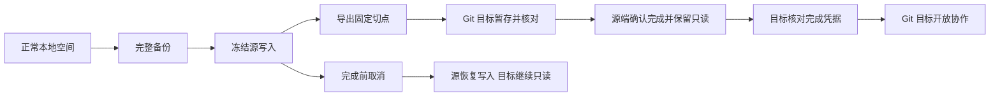

# 正式迁移与交接

当前已实现并测试 **本地源 → Git 目标** 的正式迁移库接口，保留同一工作空间 ID、全部业务 ID、原始请求、完整因果历史和实际附件。普通复制继续使用新空间 ID。[服务源 → Git 目标及本地源 → 服务目标](16-服务正式迁移与账户交接.md)、[服务源 → 本地目标](17-本地目标接收与离线接续.md)及[Git 源 → 本地／服务目标](18-Git源交接与冻结确认.md)另已接入。本地／Git 桌面向导已接入并完成原生连续往返，服务远端向导及其他完整应用边界仍未完成，不将库接口验证等同于桌面产品交付。

## 交接顺序

| 阶段 | 源业务写入 | 目标业务写入 | 允许继续的动作 |
| --- | --- | --- | --- |
| 正常 | 允许 | 尚未创建 | 先备份，再准备迁移 |
| 源冻结 `frozen` | 拒绝 | 尚未创建或只读暂存 | 读取、完整备份、重试导出、暂存核对，或明确取消 |
| 目标暂存 `staged` | 拒绝 | 拒绝 | 读取及附件核对，向源返回同一计划的核对回执 |
| 源完成 `completed` | 永久只读 | 尚待激活 | 重取同一完成凭据、导出原冻结切点、完整备份 |
| 目标激活 `active` | 永久只读 | 允许 | 业务、提交、文件包、同步和后续备份 |
| 源取消 `cancelled` | 恢复 | 原暂存目标继续只读 | 源继续工作，或使用新迁移 ID 重新准备 |

源完成后不允许取消。错误回执、错误计划、错误凭据、未完成或已取消的迁移不能让目标获得写权限；失败不自动开放任意一侧。

## 已实现接口

| 接口 | 行为 |
| --- | --- |
| `LocalWorkspace::prepare_transfer(actor, id, at, target, backup_destination)` | 检查所有者、目标和时间，先保存完整备份，再在写事务内取当前切点并冻结。相同未完成计划可重试，不重复备份或事件 |
| `LocalWorkspace::transfer_status(actor)` | 返回当前计划、源／目标身份和阶段，不返回完成令牌 |
| `LocalWorkspace::transfer_events(actor)` | 所有者读取迁移阶段事件；核对事件校验值与当前阶段，不携带令牌 |
| `LocalWorkspace::export_transfer(actor, destination)` | 导出已冻结的固定切点；同一有效目标目录可核对后重试，不覆盖不同包 |
| `GitWorkspace::stage_transfer(source, destination, actor, at)` | 校验目标所有者身份、实际操作者和暂存时间、正式包及实际字节，建立保留原空间 ID 的只读目标，返回核对报告和回执 |
| `LocalWorkspace::complete_transfer(actor, at, receipt)` | 所有者核对目标回执，事务提交源完成状态后返回完成凭据；同计划重试返回相同凭据 |
| `GitWorkspace::activate_transfer(actor, at, activation)` | 目标所有者核对计划指纹、迁移 ID 和完成令牌，激活后才允许写入；相同凭据可重试 |
| `LocalWorkspace::cancel_transfer(actor, at, id)` | 仅在源尚未完成时取消；恢复源写入，销毁该实例保存的待发令牌，不发放目标完成凭据 |
| `GitWorkspace::transfer_status(actor)` | 返回目标当前迁移阶段；冷启动、文件包及真实裸远端副本均保留状态 |
| `LocalWorkspace::stage_transfer(source, destination, actor, at)`、`activate_transfer(actor, at, activation)` | 正式包按原 ID 暂存到本地，使用同一历史安装流程；事务核对完成凭据后才开放写入，详见本地接收协议 |
| `MigrationArchive::transfer_plan`、`transfer_history` | 读取并核对正式包计划、目标模式与历史切点 |
| `MigrationHistory::export_transfer` | 复用完整历史、附件和目录校验导出正式包；源冻结由适配器负责 |

这些 Rust 库能力已接入[统一正式迁移 CLI](23-正式迁移命令行.md)，六个方向的真实进程测试通过；本地／Git 桌面操作页已接入，服务远端 HTTP 向导仍待完成。当前已接通本地 → Git、服务 → Git、本地 → 服务、服务 → 本地、Git → 本地、Git → 服务；Git 源额外要求可写成员确认切点，并阻止迟到业务或已知并行计划完成交接。

## 持久化与旧客户端

本地首次准备迁移前要求独立新备份目录，沿用现有一致 SQLite 备份。备份失败不会冻结；冻结事务失败会回滚格式、控制记录和屏障，不留下半次业务变更。

本地数据库升级为格式 3，增加迁移控制、事件及必要的空来源表。迁移记录包含计划、阶段、校验值和只读标记；尚未完成的源令牌只保存在私有数据库中。迁移事件单独保存公开状态及指纹，不伪造需求、评论或业务操作。

五张业务表的新增、更新和删除均有写入触发器。冻结前已打开的旧 SQLite 连接也会被数据库拒绝，不能只依赖新客户端入口。新客户端读取会核对 15 条屏障定义，缺失、改写、状态损坏或事件与当前记录不符时拒绝继续。老客户端冷启动会因不支持格式 3 而拒绝打开。

Git 暂存目标清单增加受控迁移信息，保持未提交状态。暂存期间拒绝业务保存、附件上传、冲突决策、业务合并、提交、导出文件包和推送；索引重建及读取仍可用。激活在首次提交前原子更新清单，之后清单作为不可变规范数据保留；不得通过外部 Git 命令提前提交暂存清单。激活后的文件包、克隆和同步会保留完成凭据与阶段，不自动退回暂存或丢失原历史。

## 交换包与凭据

普通复制包保持格式 1。正式包使用格式 2，包 ID 等于迁移 ID，包含明确源／目标模式、原空间 ID、准备人和时间、因果前沿、完整历史指纹及完成令牌摘要。旧客户端拒绝新格式；现有本地、Git、服务复制入口也会拒绝正式包，不能绕过暂存和交接直接按复制启用。

历史前沿可以从当前图重建并核对，目标继续写入后仍验证原迁移切点。后续所有者交接不会把历史准备人或激活人改成当前成员；过去的合法所有者记录继续保留。

完成凭据包含迁移 ID、计划指纹和专用于此计划的随机令牌。令牌使用现有 UUID 随机来源和 SHA-256 摘要，不新增密码学实现或第三方依赖。源确认完成前，交换包、报告和公开事件都不包含该令牌。目标激活后，已完成计划的凭据成为 Git 规范数据，供合法副本验证；它不是服务登录令牌、账户密码或通用操作权限。

SHA-256 核对完整性，不提供来源系统的数字签名。输入交换包及本机数据目录仍属于既有可信协作边界，不能将可手工改写数据的文件所有者视为不可信远端用户。

## 中断恢复与实际边界

- 导出失败：源保持冻结，可修复路径或附件后重试；不自动取消。
- 暂存失败：使用私有临时目录核对后落位，不覆盖原目标；源仍可读、可重试或取消。
- 已暂存但源未完成：目标保持只读；取消只恢复源当前实例，不激活目标。
- 源已完成而凭据交付中断：重新请求同一回执，取得相同凭据，再激活原计划。
- 目标已激活后重试暂存或激活：核对原计划，保留后续新操作，不用旧切点覆盖现有数据。
- 冻结或完成后的完整本地备份恢复：保留只读阶段和控制记录，可在确认原源已离线且没有另一处取消／完成后恢复相应交接。

本协议约束当前受控源和同一计划的目标。旧备份、手工复制出的独立源和从未同步的离线 Git 副本无法在无服务条件下自动获知另一处的交接决定；恢复旧源前必须核对实际使用中的空间，不能同时把两个恢复副本当作源继续操作。原源只保存冻结切点，交接后目标新增业务应从目标的 Git 远端或完整备份恢复。

Git 作为源已接入可传播的追加冻结记录、成员声明本人副本停写、迟到分支保留、并行计划取消及私有发起副本恢复，详见 [Git 源协议](18-Git源交接与冻结确认.md)。这不提供对未知离线设备的远程锁定；迁移前仍须盘点并同步实际副本。服务模式使用数据库事务、真实会话、身份映射、完整服务备份及恢复后的交接控制，详见服务交接协议。

验证见 [本地正式迁移记录](验证记录/2026-10-25-本地正式迁移.md)，全范围见 [交付矩阵](05-交付进度.md)。
